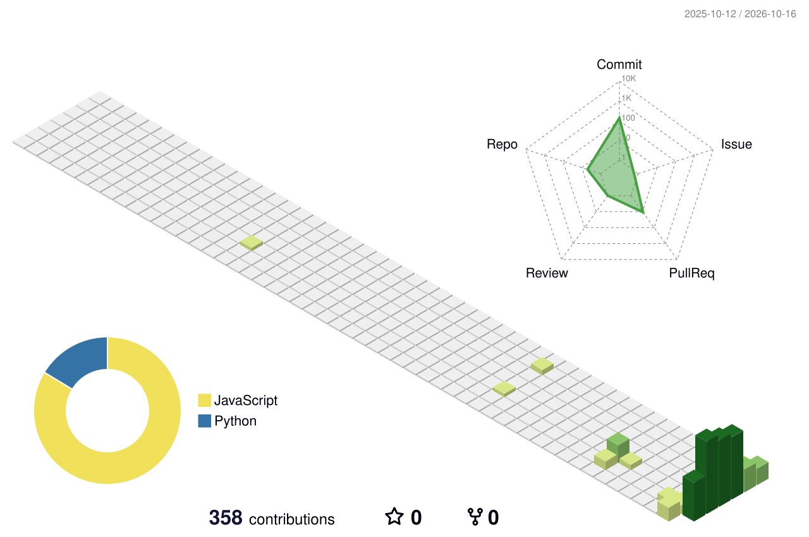

  

  

   

  
  
  

---

## A little about me

I'm not an expert, and I'm not trying to present myself as one. I'm someone who likes learning new things, trying them out, and slowly understanding how they work.

Lately, most of my attention has been on **web design and frontend development**: how a page feels, how its details fit together, and how small interactions can make an interface more enjoyable to use. I'm also starting to dig deeper into **backend development** so I can understand more of what happens beyond the screen.

I still have plenty to learn. That's the point.

## What I'm exploring

<table>
  <tr>
    <td width="50%" valign="top">
      <strong>Frontend & interface design</strong> 
      Layout, typography, responsive design, interaction details, and motion that has a reason to be there.
    </td>
    <td width="50%" valign="top">
      <strong>Backend fundamentals</strong> 
      Learning how applications handle data, connect services, and work behind the interface.
    </td>
  </tr>
  <tr>
    <td width="50%" valign="top">
      <strong>Learning by building</strong> 
      Trying ideas in small projects, finding what breaks, and improving them as I understand more.
    </td>
    <td width="50%" valign="top">
      <strong>Design & motion</strong> 
      Interested in expressive UI, thoughtful transitions, and interfaces that feel considered rather than overdone.
    </td>
  </tr>
</table>

  

## A project I'm working on

<a href="https://github.com/farid-crafts/portooo"><strong>Portooo — interactive portfolio</strong></a>

A neubrutalist portfolio experiment with live GitHub data, theme switching, and an animated mascot. I'm using it to explore frontend structure, motion, and how a small visual idea can become an interactive experience.

## My GitHub, lately

  
  

  

## Currently on repeat

  
  
A little soundtrack for learning, designing, and figuring things out.

## The contribution garden

  
  A 3D view of my GitHub activity, refreshed automatically every day.

  Still learning. Still experimenting. One project at a time.
   
  

